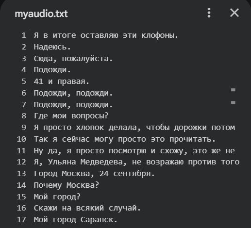
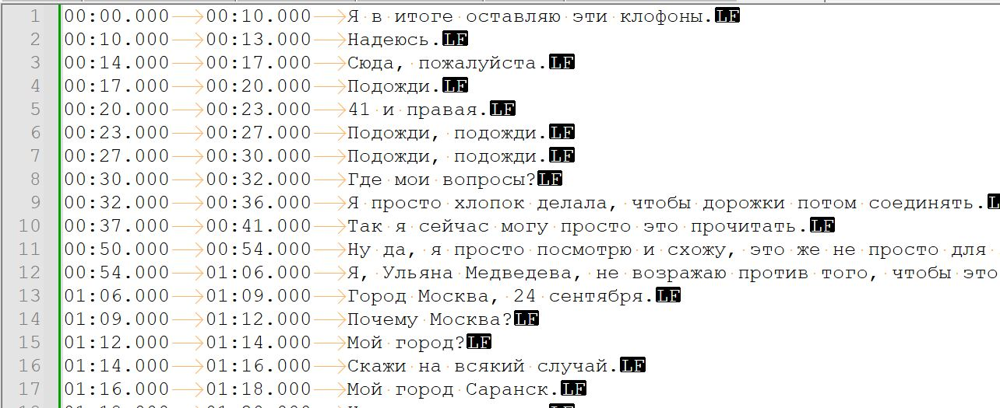
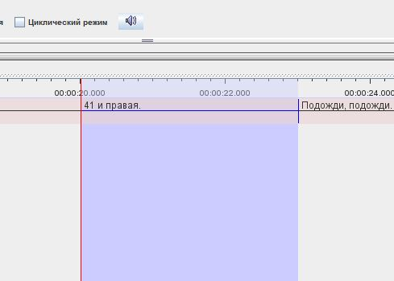
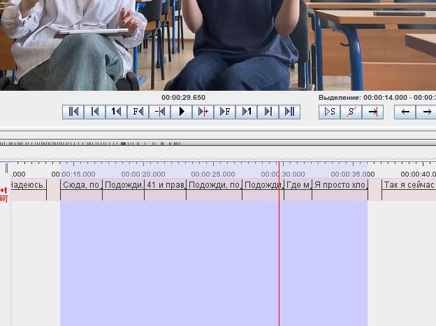

## ASR сделала по инструкции из дз с некоторыми дополнительными действиями
1. После выполнения кода получила файл myaudio.txt *(не tsv)*, который по формату не совсем совпадает с требуемым в Elan *(напр. строка 4 выглядела так: [00:17.000 --> 00:20.000]  Подожди.)*

2. В Notepad++ с помощью регулярных выражений привела все строки к формату с табуляцией и без квадратных скобок *(00:17.000  00:20.000  Подожди.)*

3. Импортировала в Elan (разделитель - Tab, первая колонка - время начала, вторая - время окончания, третья - аннотация)
4. Переименовала слой и прикрепила видеофайл
## Проблемы и недостатки ASR, которые обнаружились при работе
1. В файле myaudio.txt всего лишь 100 строк, то есть из 32 минут видео размеченными оказались только первые 6
2. Из-за качества записи звука и тихой речи нейросеть распознала не все реплики и некоторые разпознала с ошибками (напр. "эти клофоны" вместо "диктофон", "41 и правая" вместо "в 41 мы имеем право")

3. В репликах, распознанных нейросетью, расставлена пунктуация, как в конце предложения, так и внутри него, каждое предложение начинается с большой буквы
4. Время начала и окончания реплики определено неточно (реплика находится внутри указанного временного промежутка, но в начале или в конце есть пауза длиной до 2 секунд)
5. Большие паузы между группами реплик определены правильно, но внутри самой группы реплики идут подряд, без разделения и микропауз

6. В результате работы нейросети получили разметку для одного слоя, что является проблемой, так как на нашем видео присутвуют 2 человека, которые нередко говорят параллельно 
